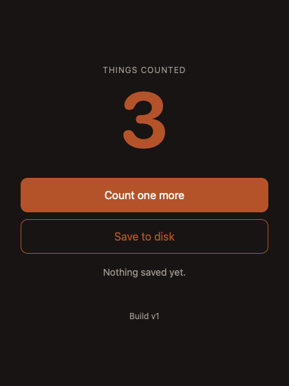
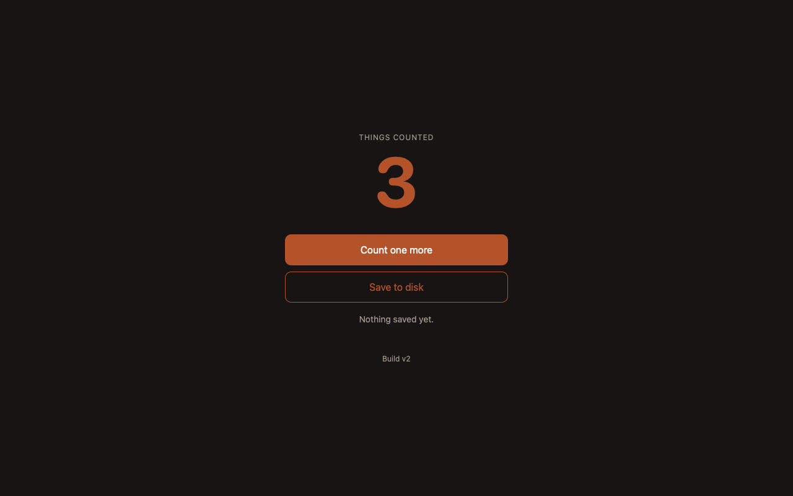

# Rusty Mirror

[](https://github.com/michael-berardi/rusty-mirror/releases/latest) [](LICENSE)  

Rusty Mirror gives Tauri developers and UI-testing agents a hidden second
window inside their app. It uses the app's native webview and frontend,
seeded with a snapshot of the primary window's state. Inspect the DOM, take
native screenshots on macOS, and try rebuilt frontends before reloading the
primary window.

The mirror rejects app commands outside your allowlist. It is development
tooling for trusted code, not an OS sandbox: allowlisted native commands
still have the app's full permissions.

## Install

Install the CLI with Cargo:

```sh
cargo install --git https://github.com/michael-berardi/rusty-mirror --tag v0.2.0 --locked rusty-mirror-cli
rusty-mirror --help
```

Use a current stable Rust toolchain and Tauri 2.5 or later. The workspace
manifest declares Rust 1.80, but the locked dependencies include crates
requiring Rust 1.88; Rust 1.80 is not sufficient for this checkout.

The CLI needs a mirror-enabled build of your app. Add the optional plugin:

```toml
# src-tauri/Cargo.toml
[features]
mirror-debug = ["dep:rusty-mirror"]

[dependencies]
rusty-mirror = { git = "https://github.com/michael-berardi/rusty-mirror", tag = "v0.2.0", optional = true }
```

Follow [the integration guide](docs/integrate.md) to install the asset
wrapper, guard your invoke handler, register the plugin, and supply a
frontend snapshot hook. Keep both Rust and frontend mirror code behind
non-default build gates. [Tally](examples/tally) is a complete example.

## First use

With your mirror-enabled app running:

```sh
rusty-mirror open --seconds 600
rusty-mirror eval 'return document.title'
rusty-mirror capture shots/before.png
rusty-mirror close
```

The window stays hidden and unfocused. Captures never overwrite files;
inspect each image rather than treating its existence as a passed check.
Use `--app <identifier>` when multiple apps have control sockets.

To test a rebuilt frontend, build it with its mirror gate enabled and a
relative asset base, then run:

```sh
rusty-mirror open
rusty-mirror stage dist
rusty-mirror refresh <revision>       # use the digest returned by stage
rusty-mirror eval 'return document.readyState'
rusty-mirror capture shots/after.png
rusty-mirror close
```

Refresh needs embedded assets (`custom-protocol`), not a dev-server URL.
It carries the mirror's state forward; navigation is asynchronous, so check
an app-specific readiness condition before capturing. `rollback` restores
the previous mirror revision. `apply` reloads the primary on the staged
revision: only do this after inspection and when reloading is safe. It does
not copy mirror storage or replace native code.

`rusty-mirror run --seconds 600 -- ./qa/visual-check.sh` opens a mirror,
waits for your script, then attempts to close it. The finite lifetime is a
backstop, not a replacement for cleanup. See the [CLI reference](docs/cli.md)
for commands, output and exit codes, or the [agent skill](skills/rusty-mirror).

## Screenshots

Bundled Tally captures show count 3 before and after a frontend refresh:

<p align="center">
  
  
</p>

## Safety and platforms

- Allow only read-only app commands, and wrap the invoke handler with `guard`.
- Keep `rusty-mirror` out of Tauri capabilities, including wildcard grants.
- The default CSP restricts network access; storage is memory-backed in an
  incognito webview. Custom policies and same-origin requests need care.
- Control uses a same-user Unix socket. Any process running as you can use it.
- Mirrors expire after 1–3600 seconds (default 900).
- Audit consumer frontends and binaries with `rusty-mirror audit`, but treat
  marker scanning as a check, not a proof of complete isolation.

See the [security model](docs/security.md) and [reporting policy](SECURITY.md).

| Platform | Status |
| --- | --- |
| macOS 14+ | Native mirror and `WKWebView.takeSnapshot` capture; no Screen Recording permission needed |
| Linux | Core and CLI use Unix APIs; plugin and capture support are not validated here |
| Windows | Unsupported: no socket transport |

## Contributing

From a fresh checkout:

```sh
examples/tally/build.sh
cargo fmt --all --check
cargo test -j4
cargo clippy --workspace --all-targets --features tally/mirror-debug -j4
```

The frontend build is required because the default workspace includes Tally.
On macOS, `CARGO_BUILD_JOBS=4 scripts/e2e.sh` builds and **launches** the example
app off-screen to test the native workflow. See [CONTRIBUTING.md](CONTRIBUTING.md).

## License

[MIT](LICENSE).

---

Part of [Pareto Cybernetics](https://paretocybernetics.com/projects/rusty-mirror/): free, private, open-source tools for working with AI agents.
